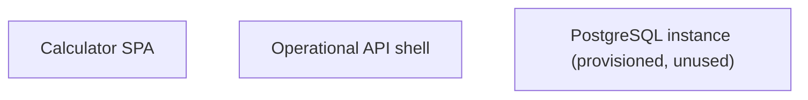
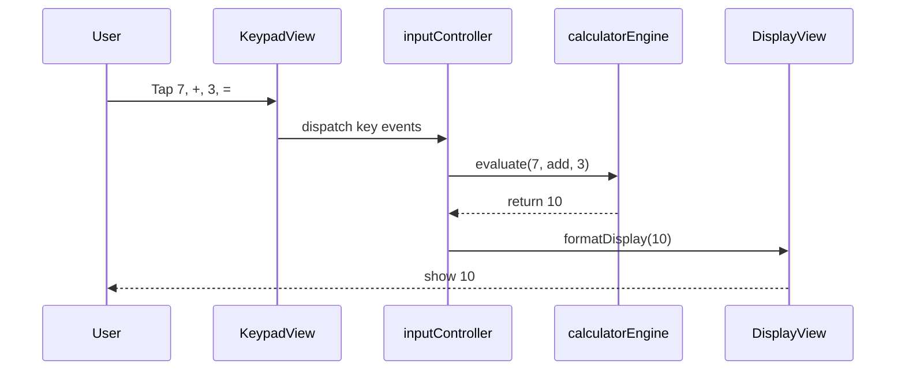
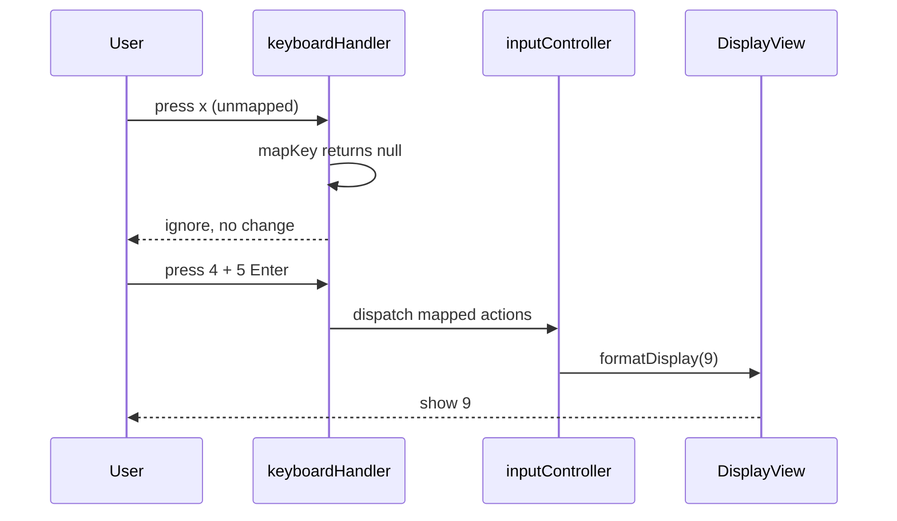
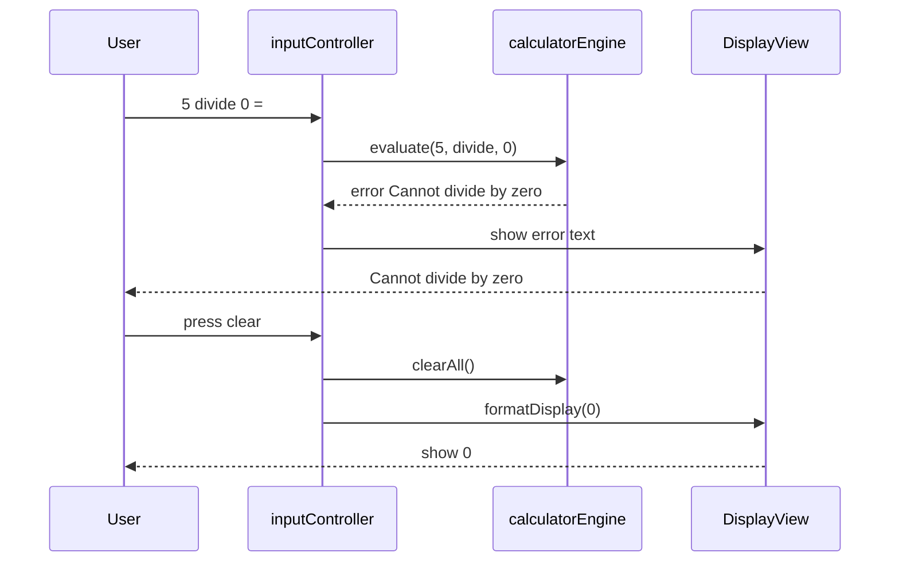
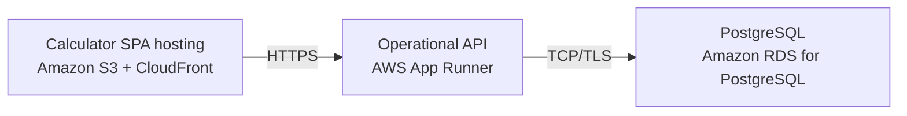

# Architecture

> Maintained by QuorQ AI SDLC. Text between `sdlc:auto` markers is regenerated; anything outside them is yours and is kept.

<!-- sdlc:auto:start narrative -->
## Overview

### ARCH-COMP-FRONTEND · approved · source: architecture:component:frontend

Calculator SPA built with React 19, rendering the UI from Magic UI components and running all arithmetic in the browser.

Renders the responsive calculator UI from Magic UI React components (previewed via the Magic UI MCP integration, US-011). Handles both on-screen-button and keyboard input. Performs add, subtract, multiply, divide, percentage, decimal entry, sign-toggle and clear entirely client-side. Surfaces divide-by-zero as a clear error rather than crashing (US-008). No data leaves the browser -- there is no server-side calculation logic or persistence.

**Related:** US-011, US-008

### ARCH-COMP-BACKEND · approved · source: architecture:component:backend

Thin FastAPI 0.115 operational shell that exposes only a health check.

Exposes a single health-check endpoint and reserves room for future operational endpoints. Holds no calculator business logic -- every calculation runs in the browser, consistent with the client-side computation requirement noted in the input (referenced there as NFR-002, not among the known requirement keys for this project).

### ARCH-COMP-DATABASE · approved · source: architecture:component:database

PostgreSQL 16 instance provisioned to fill the data layer but currently unused.

Provisioned to satisfy the architecture's data layer only. The product stores no user data, history, or accounts -- the input attributes this to requirements referenced as NFR-003 and AC-028, which are not among the known requirement keys supplied for this project. No tables carry user-facing data today; the instance stands ready should server-side persistence be added later.

### ARCH-CP-CALCULATE · approved · source: architecture:critical-path:Perform an arithmetic calculation

Primary flow: user enters two operands and an operator, then triggers computation.

User enters two operands and an operator via on-screen buttons or keyboard and presses equals or Enter; the calculator computes and displays the result immediately in the browser, with no round-trip to the backend.

### ARCH-CP-KEYBOARD · approved · source: architecture:critical-path:Keyboard input and ignored keys

Keyboard-only operation path, including handling of unmapped keys.

User types digits and operators and presses Enter to compute. Unmapped keys are ignored, leaving the display unchanged. This keeps the app fully keyboard-operable (referenced in the input as NFR-004, not among the known requirement keys supplied for this project).

### ARCH-CP-DIVZERO · approved · source: architecture:critical-path:Divide by zero and recovery

Error handling and recovery path for division by zero.

Dividing by zero produces a clear error indication instead of crashing the app. Pressing clear resets the display to 0, returning the calculator to a ready state (US-008).

**Related:** US-008

### ARCH-EP-HEALTH · approved · source: architecture:endpoint:GET /health

Liveness/readiness probe for the operational API shell.

GET /health returns service status for the FastAPI backend. Contains no calculator logic; exists purely as an operational check.

### ARCH-DEPLOY-SPA · approved · source: architecture:deployment-node:Calculator SPA hosting

Static hosting for the React 19 SPA via Amazon S3 and CloudFront.

The static React 19 production build is hosted on Amazon S3 and distributed globally through CloudFront, chosen for low-latency public reach (NFR-005 per the input, not among known requirement keys).

### ARCH-DEPLOY-API · approved · source: architecture:deployment-node:Operational API

AWS App Runner hosts the FastAPI operational shell.

FastAPI 0.115 runs on Python/Uvicorn inside AWS App Runner, serving the health-check endpoint. Deployed on a separate origin from the SPA.

### ARCH-DEPLOY-DB · approved · source: architecture:deployment-node:PostgreSQL

Amazon RDS for PostgreSQL hosts the provisioned-but-unused database.

PostgreSQL 16 runs on Amazon RDS. Provisioned to complete the data layer; currently holds no user-facing data.

### ARCH-TECH-FRONTEND · approved · source: architecture:technology-decision:Frontend

React 19 chosen as the frontend framework, hosting the whole product and the Magic UI component set.

Approved choice: React 19 (alternatives considered: Vue 3, Svelte). The calculator UI is assembled from Magic UI components, which are React components integrated and previewed via the Magic UI MCP integration (US-011). All arithmetic and input handling run in these components in the browser.

**Related:** US-011

### ARCH-TECH-BACKEND · approved · source: architecture:technology-decision:Backend

FastAPI 0.115 chosen as a thin backend shell with no business logic.

Approved choice: FastAPI 0.115 (alternatives considered: Flask, Express). Kept thin, serving only a health check and reserving room for future operational endpoints. No calculator business logic server-side because calculations run entirely in the browser (referenced in the input as NFR-002, not among known requirement keys).

### ARCH-TECH-DATABASE · approved · source: architecture:technology-decision:Database

PostgreSQL 16 chosen as the database, provisioned empty.

Approved choice: PostgreSQL 16 (alternatives considered: SQLite, DynamoDB). Provisioned empty to fill the data layer; the product stores no user data, history, or accounts (referenced in the input as NFR-003, AC-028, not among known requirement keys), so no schema holds user-facing data.

### ARCH-TECH-CLOUD · approved · source: architecture:technology-decision:Cloud

AWS chosen as the cloud provider for hosting the free, public, lightweight app.

Approved choice: AWS (alternatives considered: Google Cloud, Azure). CloudFront fronts the static SPA for global low-latency reach; App Runner hosts the thin API. Meets the public-scale reachability requirement referenced in the input as NFR-005, not among known requirement keys.
<!-- sdlc:auto:end narrative -->

<!-- sdlc:auto:start building-blocks -->
## Building Block View

| ID | Name | Technology | Responsibility | Depends on |
|---|---|---|---|---|
| frontend | Calculator SPA | React 19 | Renders the responsive calculator UI from Magic UI components, handles on-screen and keyboard input, runs all arithmetic (add/subtract/multiply/divide/percentage/decimal/sign-toggle/clear) in the browser, and surfaces divide-by-zero as a clear error. No data leaves the browser. | — |
| backend | Operational API shell | FastAPI 0.115 | Thin service that exposes a health check and leaves room for future operational endpoints. It holds no calculator business logic because every calculation runs in the browser. | — |
| database | PostgreSQL instance (provisioned, unused) | PostgreSQL 16 | Provisioned to satisfy the data layer only. The product stores no user data, history or accounts (NFR-003), so no tables carry user-facing data; it stands ready should server-side persistence be added later. | — |

<!-- sdlc:auto:end building-blocks -->

<!-- sdlc:auto:start runtime -->
## Runtime View

### Perform an arithmetic calculation

User enters two operands and an operator via buttons or keyboard and presses equals/Enter; the calculator computes and displays the result immediately in the browser.

- **Components:** frontend
- **Modules:** calculatorEngine, inputController, DisplayView, KeypadView
- **Key functions:** inputDigit(char), setOperator(op), applyPercentage(value), toggleSign(value), evaluate(left, op, right), formatDisplay(value)

### Keyboard input and ignored keys

User types digits and operators and presses Enter; unmapped keys are ignored so the display is unchanged, keeping the app fully keyboard-operable (NFR-004).

- **Components:** frontend
- **Modules:** keyboardHandler, inputController, DisplayView
- **Key functions:** mapKey(event), handleKeyDown(event), inputController.dispatch(action)

### Divide by zero and recovery

Dividing by zero produces a clear error indication instead of crashing; pressing clear resets the display to 0 and the calculator is ready again (US-008).

- **Components:** frontend
- **Modules:** calculatorEngine, inputController, DisplayView
- **Key functions:** evaluate(left, divide, 0), handleError(code), clearAll()

<!-- sdlc:auto:end runtime -->

<!-- sdlc:auto:start deployment-view -->
## Deployment View

| Name | Service | Runtime | Scaling | Environment |
|---|---|---|---|---|
| Calculator SPA hosting | Amazon S3 + CloudFront | Static React 19 build | CDN edge, scales to public traffic automatically | dev |
| Operational API | AWS App Runner | FastAPI 0.115 on Python (Uvicorn) | Managed autoscaling, min 1 instance | dev |
| PostgreSQL | Amazon RDS for PostgreSQL | PostgreSQL 16 | Single small instance (provisioned, unused) | dev |

| Source | Target | Protocol |
|---|---|---|
| Calculator SPA hosting | Operational API | HTTPS |
| Operational API | PostgreSQL | TCP/TLS |

<!-- sdlc:auto:end deployment-view -->

<!-- sdlc:auto:start decisions -->
## Architecture Decisions

| Layer | Choice | ADR |
|---|---|---|
| Frontend | React 19 | [ADR-0001](adr/frontend.md) |
| Backend | FastAPI 0.115 | [ADR-0002](adr/backend.md) |
| Database | PostgreSQL 16 | [ADR-0003](adr/database.md) |
| Cloud | AWS | [ADR-0004](adr/cloud.md) |
<!-- sdlc:auto:end decisions -->

<!-- sdlc:auto:start links -->
## Related Documents

- [Data Model](data-model.md)
- [API Specification](api/openapi.yaml)
- [Architecture Decision Records](adr/README.md)
<!-- sdlc:auto:end links -->
